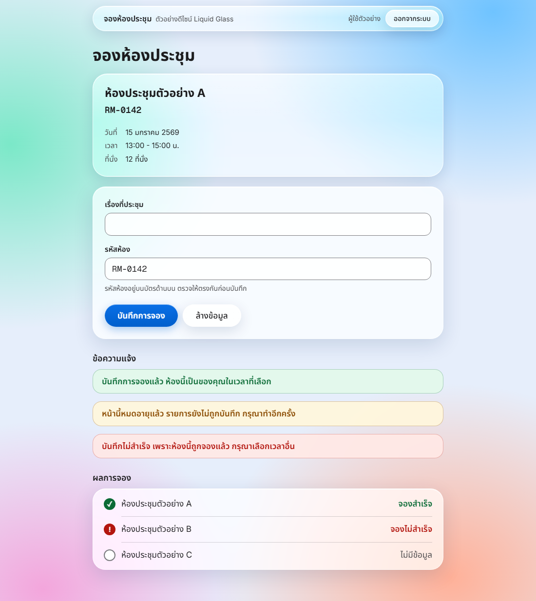

# ko-design

คลังดีไซน์เว็บในรูปแบบ [Claude Code](https://claude.com/claude-code) skill เมื่อสั่งให้ Claude ออกแบบเว็บ Claude จะถามก่อนว่าจะใช้ดีไซน์ไหน แล้วทำตามเอกสารของดีไซน์นั้น หน้าตาของแต่ละเว็บจึงอ้างอิงจากมาตรฐานเดียวกัน



## ดีไซน์ที่มี

| ดีไซน์ | ลักษณะ | เอกสาร | หน้าตัวอย่าง |
| --- | --- | --- | --- |
| Liquid Glass | แผ่นกระจกโปร่งแสงลอยเหนือภาพพื้นสีสด แนวเดียวกับ iPhone | [DESIGN.md](designs/liquid-glass/DESIGN.md) | [index.html](designs/liquid-glass/example/index.html) |

หน้าตัวอย่างเปิดบนหน้า GitHub ไม่ได้ ให้ clone repo แล้วเปิดไฟล์ `index.html` ด้วยเบราว์เซอร์

## ติดตั้ง

```bash
git clone https://github.com/Kriangsak1416/ko-design.git ~/.claude/skills/ko-design
```

## ใช้งาน

สั่ง Claude ตามปกติ เช่น "ออกแบบเว็บจองห้องประชุมให้หน่อย" หรือเรียก `/ko-design` ถ้าระบุชื่อดีไซน์มาในคำสั่ง Claude จะใช้ดีไซน์นั้นโดยไม่ถามซ้ำ

## โครงสร้าง

```
ko-design/
├── SKILL.md                  รายการดีไซน์และขั้นตอนที่ Claude ทำตาม
└── designs/
    └── <ชื่อดีไซน์>/
        ├── DESIGN.md         มาตรฐานของดีไซน์
        ├── fonts/            ฟอนต์และไฟล์ไลเซนส์
        └── example/          หน้าตัวอย่าง
```

## เพิ่มดีไซน์ใหม่

1. สร้างโฟลเดอร์ `designs/<ชื่อดีไซน์>/` แล้วเขียน `DESIGN.md` โดยไม่ขัดกับ "ข้อห้ามของทุกดีไซน์" ใน `SKILL.md`
2. เพิ่มแถวในตาราง "ดีไซน์ที่มี" ของ `SKILL.md` และของไฟล์นี้
3. เพิ่มชื่อดีไซน์ใน `description` ด้านบนของ `SKILL.md`

## ไลเซนส์ของฟอนต์

Inter, Noto Sans Thai และ Geist Mono ใช้ไลเซนส์ SIL Open Font License 1.1 ดูข้อความเต็มได้ใน [designs/liquid-glass/fonts/](designs/liquid-glass/fonts/)
